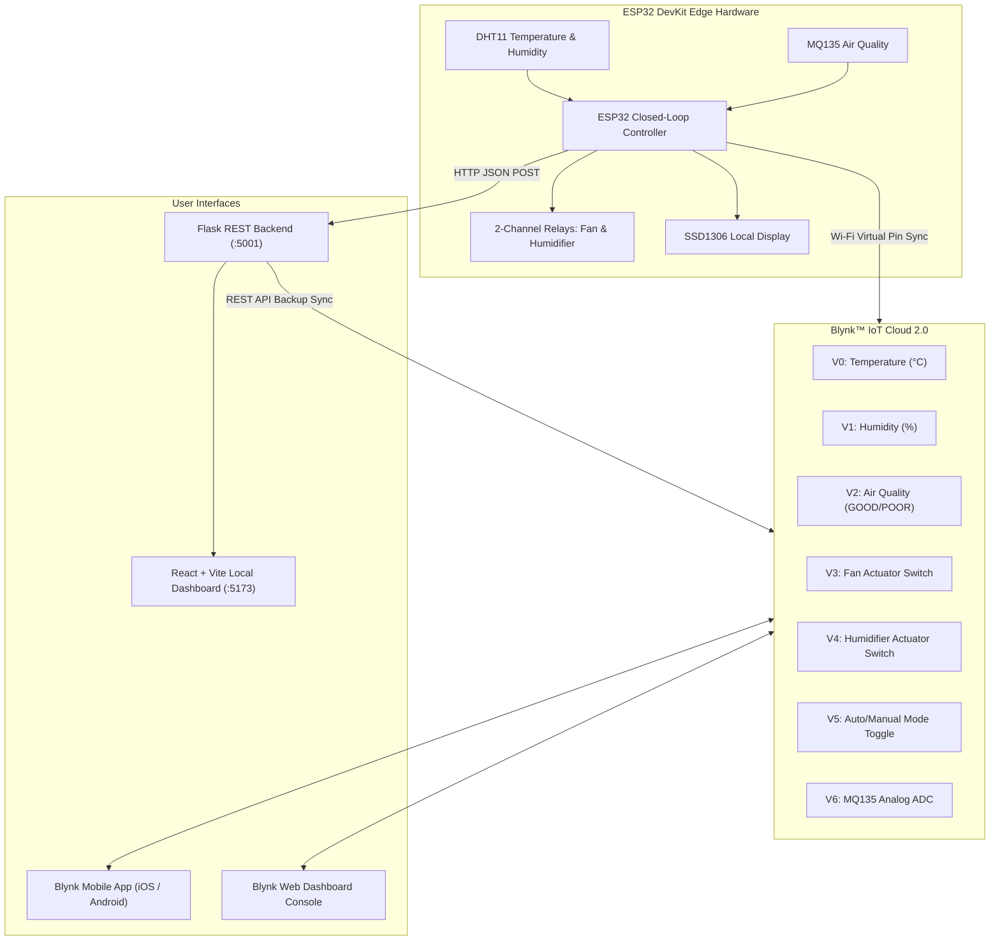

# IoT and AI Based Smart Mushroom Cultivation System for Contamination Detection and Yield Prediction

**Final-Year B.E. Electronics and Communication Engineering Capstone Project**

---

## 1. Project Overview & Architecture

This project is an integrated, end-to-end cyber-physical IoT and AI system designed to monitor, automate, and diagnose mushroom cultivation environments in real-time.

### Full-Stack Architecture Pipeline

```
[ ESP32 IoT Microcontroller ]
   ├── DHT11 (Temp & Humidity)
   ├── MQ135 (Air Quality / CO2)
   ├── Relay 1 (Exhaust Fan)
   └── Relay 2 (Humidifier)
               │
          (Wi-Fi HTTP POST /api/sensor-data every 3s)
               ▼
   [ Python Flask REST Backend :5000 ] <───────────────────────────┐
      ├── In-Memory Telemetry State                                │
      ├── Yield Records & System Alert Logs                        │
      └── Reverse Proxy / Request Forwarder                        │
               │                                                   │
          (POST /predict)                                (REST Polling & Mutate)
               ▼                                                   │
   [ FastAPI ML Inference Service :8000 ]                          │
      ├── Image Preprocessing (128x128x3 RGB)                      │
      ├── TensorFlow/Keras CNN Autoencoder                         │
      ├── Reconstruction Error (MSE) Calculation                   │
      └── Empirical 95th Percentile Threshold Comparison           ▼
                                                     [ React + Vite Dashboard :5173 ]
                                                        ├── Overview Telemetry Cards
                                                        ├── Contamination Image Upload
                                                        ├── Yield Tracking (Recharts)
                                                        ├── System Alerts Feed
                                                        └── Settings & Live Probes
```

---

## 2. Directory Structure

```
mushroom-iot-project/
├── esp32/
│   └── mushroom_monitor.ino     # ESP32 firmware with WiFi, sensor reading, relay logic
│
├── backend/ (or mushroom-backend/)
│   ├── app.py                   # Flask REST API hub
│   ├── requirements.txt         # Backend Python dependencies
│   ├── .env.example             # Flask environment variables
│   └── README.md                # Backend API documentation
│
├── frontend/ (or mushroom-frontend/)
│   ├── src/                     # React components, pages, and centralized API client
│   ├── package.json             # Frontend NPM scripts and dependencies
│   ├── vite.config.js           # Vite development server config
│   ├── .env.example             # Frontend environment variables
│   └── README.md                # Frontend documentation
│
├── ml/
│   ├── dataset/                 # Train, Validation, and Test image sets
│   ├── model/                   # Trained .keras model and threshold.json
│   ├── training/                # Training & 95th-percentile threshold scripts
│   ├── evaluation/              # Test set evaluation & confusion matrix
│   ├── inference/               # Reusable prediction & confidence module
│   ├── preprocessing/           # Image loader, validator, and normalization
│   ├── api/main.py              # FastAPI microservice (:8000)
│   ├── requirements.txt         # ML Python dependencies (TensorFlow, FastAPI, etc.)
│   ├── .env.example             # ML environment variables
│   └── README.md                # Detailed ML methodology & Viva guide
│
└── README.md                    # Root project documentation (this file)
```

---

## 3. Hardware Specifications & Pin Configuration

| Component | ESP32 GPIO Pin | Function / Logic |
|---|---|---|
| **DHT11 Sensor** | `GPIO 5` | Temperature (°C) and Relative Humidity (%) |
| **MQ135 Sensor** | `GPIO 34` | Air Quality (Analog/Digital ADC for CO2/ammonia) |
| **Relay 1 (Exhaust Fan)** | `GPIO 26` | Autonomous ventilation when air quality is `POOR` |
| **Relay 2 (Humidifier)** | `GPIO 27` | Autonomous misting when humidity is `< 75.0%` |
| **OLED Display (Optional)** | `SDA: 21, SCL: 22` | Local I2C SSD1306 chamber display (0x3C) |

---

## 4. Port Allocations & Network Topology

| Component | Host / IP | Port | URL |
|---|---|---|---|
| **React Frontend** | `localhost` | `5173` | `http://localhost:5173` |
| **Flask Backend** | `0.0.0.0` | `5000` | `http://localhost:5000` |
| **FastAPI ML Service**| `0.0.0.0` | `8000` | `http://localhost:8000` |
| **ESP32 Hardware** | *Laptop LAN IP* | `5000` | `http://<LAPTOP_LAN_IP>:5000/api/sensor-data` |

> [!CRITICAL]
> **ESP32 Network Address Notice:**  
> The ESP32 must **never** send telemetry to `localhost` or `127.0.0.1`, because `localhost` inside ESP32 firmware refers to the microcontroller itself.  
> You must set `BACKEND_URL` in `esp32/mushroom_monitor.ino` to your laptop's local Wi-Fi IP address (e.g. `http://192.168.1.100:5000/api/sensor-data`).

### How to Find Your Laptop's LAN IP:
- **macOS / Linux:** Run `ipconfig getifaddr en0` or `hostname -I` in terminal.
- **Windows:** Run `ipconfig` in Command Prompt and check `IPv4 Address`.

---

## 5. Recommended Startup Order

Follow this 4-step startup sequence to run the entire system:

### Terminal 1: Start FastAPI ML Service (Port 8000)
```bash
cd ml
python3 -m venv venv
source venv/bin/activate       # Windows: venv\Scripts\activate
pip install -r requirements.txt
uvicorn api.main:app --host 0.0.0.0 --port 8000
```

### Terminal 2: Start Flask Backend (Port 5000)
```bash
cd backend
python3 -m venv venv
source venv/bin/activate       # Windows: venv\Scripts\activate
pip install -r requirements.txt
python3 app.py
```

### Terminal 3: Start React Frontend (Port 5173)
```bash
cd frontend
npm install
npm run dev
```

### ESP32 Hardware:
1. Open `esp32/mushroom_monitor.ino` in Arduino IDE.
2. Update `WIFI_SSID`, `WIFI_PASSWORD`, and `BACKEND_URL` with your Wi-Fi name and laptop LAN IP.
3. Flash the code to your ESP32 DevKit and open Serial Monitor (115200 baud).

---

## 6. How to Train & Evaluate the CNN Autoencoder

```bash
cd ml
source venv/bin/activate

# 1. Place healthy training images into dataset/train/healthy/
# 2. Place healthy validation images into dataset/validation/healthy/
# 3. Place test images into dataset/test/healthy/ and dataset/test/contaminated/

# 4. Train the autoencoder
python training/train_autoencoder.py --epochs 30 --batch-size 32

# 5. Calculate the 95th percentile empirical anomaly threshold
python training/calculate_threshold.py --percentile 95

# 6. Evaluate on the test dataset
python evaluation/evaluate_model.py
```

---

## 7. REST API Endpoints

| Method | Endpoint | Source / Consumer | Description | Request Payload / Response |
|---|---|---|---|---|
| `GET` | `/api/health` | React / Probes -> Flask | Probes Flask and ML service availability | `{ "status": "healthy", "service": "mushroom-backend", "ml_service": "available" }` |
| `GET` | `/api/sensors` | React -> Flask | Returns latest sensor telemetry (null until ESP32 streams) | `{ "temperature": 24.5, "humidity": 82.0, "air_quality": "GOOD", ... }` |
| `POST` | `/api/sensor-data` | ESP32 -> Flask | Ingests validated ESP32 telemetry packet | `{ "temperature": 24.5, "humidity": 82.0, "air_quality": "GOOD", "fan_status": false, "humidifier_status": true }` |
| `POST` | `/api/predict` | React -> Flask -> ML | Forwards substrate image to ML service | `multipart/form-data` with `image` file |
| `GET` | `/api/predictions` | React -> Flask | Returns list of recent contamination analyses | `[{ "id": 1, "detected_class": "HEALTHY", "confidence": 85.0, ... }]` |
| `GET` | `/api/yield` | React -> Flask | Returns harvest yield comparison records | `[{ "day": "Day 7", "predicted_kg": 2.5, "actual_kg": 2.3 }]` |
| `POST` | `/api/yield` | React -> Flask | Inserts new harvest yield record | `{ "day": "Day 7", "predicted_kg": 2.5, "actual_kg": 2.3 }` |
| `GET` | `/api/alerts` | React -> Flask | Returns recent system alerts feed | `[{ "id": 1, "severity": "WARNING", "message": "Low humidity" }]` |
| `POST` | `/api/alerts` | React -> Flask | Dispatches manual or incident alert | `{ "severity": "WARNING", "message": "Low humidity" }` |
| `GET` | `/health` (Port 8000) | Flask -> FastAPI ML | Health probe of ML service and model load state | `{ "status": "ok", "model_loaded": true, "threshold_loaded": true }` |
| `POST` | `/predict` (Port 8000)| Flask -> FastAPI ML | Performs CNN Autoencoder inference | `{ "detected_class": "HEALTHY", "anomaly_score": 0.42, "confidence": 85.0, "reconstruction_error": 0.0021, "threshold": 0.0045 }` |

---

## 8. Viva Defense Summary & Scientific Limitation

> [!IMPORTANT]
> **Key Viva Explanation Point:**  
> The system employs **Unsupervised Visual Anomaly Detection via a Convolutional Autoencoder (CNN Autoencoder)**.  
> - **Principle:** The network learns the latent visual features (color, texture, mycelium growth patterns) of **healthy** mushroom bags.
> - **Inference:** When an anomalous or moldy image is tested, the model fails to reconstruct the unfamiliar patterns, producing high Mean Squared Error ($MSE$).
> - **Labeling:** The system classifies images as `HEALTHY` or `POSSIBLE_CONTAMINATION`.
> - **Limitation:** It detects visual anomaly deviations from the healthy training distribution; it does **not** identify a specific biological pathogen or bacterial strain without labeled multi-class supervised training data. `anomaly_score` and `confidence` are deterministic metrics derived from distance to threshold, not medical probabilities.

---

## 9. Data Persistence Note

This prototype utilizes **in-memory data storage** on the Flask backend to maximize portability and avoid database setup overhead during viva demonstrations. All sensor telemetry, prediction histories, yield records, and alerts reset cleanly when the Flask server restarts.

---

## 10. ThingSpeak™ IoT Cloud Integration

This system supports **dual-sync cloud logging** to **MathWorks ThingSpeak IoT Cloud** for remote graphs, historical time-series storage, and MATLAB analytics:

### Cloud Field Mapping:
| Field | Metric | Data Type / Values |
|---|---|---|
| **Field 1** | Temperature | Numeric (°C) |
| **Field 2** | Humidity | Numeric (%) |
| **Field 3** | Air Quality | `0` = GOOD, `1` = POOR |
| **Field 4** | Exhaust Fan Status | `0` = OFF, `1` = ON |
| **Field 5** | Humidifier Status | `0` = OFF, `1` = ON |

### How to Enable ThingSpeak Cloud Sync:
1. Create a free account at [ThingSpeak.com](https://thingspeak.com).
2. Click **New Channel**, name it `Smart Mushroom Cultivation`, and enable **Field 1 through Field 5**.
3. Go to the **API Keys** tab and copy your **Write API Key** and **Channel ID**.
4. Add them to `backend/.env`:
   ```env
   THINGSPEAK_ENABLED=true
   THINGSPEAK_WRITE_API_KEY=YOUR_COPIED_WRITE_KEY
   THINGSPEAK_CHANNEL_ID=YOUR_CHANNEL_ID
   ```
5. Restart your backend (`python3 app.py`). The backend will automatically sync new telemetry packets to ThingSpeak every 15 seconds (respecting ThingSpeak's rate limit), and the React Settings page will display live cloud sync statistics with a direct link to your cloud graphs!

---

## 11. Blynk™ IoT Cloud 2.0 Integration

The system includes native, real-time integration with **Blynk™ IoT Cloud 2.0**, enabling remote monitoring from anywhere in the world through the **Blynk Mobile App (iOS & Android)** and the **Blynk Web Console**.



### Virtual Pin Datastream Mapping:
| Virtual Pin | Datastream Name | Data Type | Range / Values | Widget Recommended |
|---|---|---|---|---|
| **V0** | Temperature | Double | 0.0 – 60.0 °C | Radial Gauge / Value Display |
| **V1** | Humidity | Double | 0.0 – 100.0 % | Radial Gauge / Value Display |
| **V2** | Air Quality | String | `GOOD`, `POOR` | Value Display / Label |
| **V3** | Exhaust Fan Relay | Integer | `0` = OFF, `1` = ON | Switch / Button Widget |
| **V4** | Humidifier Relay | Integer | `0` = OFF, `1` = ON | Switch / Button Widget |
| **V5** | Mode Selection | Integer | `0` = AUTO, `1` = MANUAL | Switch Widget (Override Toggle) |
| **V6** | MQ135 Raw ADC | Integer | 0 – 4095 | Line Chart / SuperChart |

---

### Step-by-Step Setup Instructions:

#### 1. Create a Blynk Cloud Account
1. Visit [blynk.cloud](https://blynk.cloud) and sign up for a free account.
2. Install the **Blynk IoT** app on your phone from the Apple App Store or Google Play Store.

#### 2. Create a Device Template
1. In the Blynk Web Console, navigate to **Templates** -> **+ New Template**.
2. Set:
   - **Name**: `Mushroom Monitor`
   - **Hardware**: `ESP32`
   - **Connection Type**: `WiFi`
3. Click **Done**.

#### 3. Configure the Datastreams
Under your template, go to the **Datastreams** tab and add the following:
- **V0**: New Datastream -> Virtual Pin -> Pin `V0` -> Data Type `Double`, Min `0`, Max `60`, Units `°C`.
- **V1**: New Datastream -> Virtual Pin -> Pin `V1` -> Data Type `Double`, Min `0`, Max `100`, Units `%`.
- **V2**: New Datastream -> Virtual Pin -> Pin `V2` -> Data Type `String`.
- **V3**: New Datastream -> Virtual Pin -> Pin `V3` -> Data Type `Integer`, Min `0`, Max `1`.
- **V4**: New Datastream -> Virtual Pin -> Pin `V4` -> Data Type `Integer`, Min `0`, Max `1`.
- **V5**: New Datastream -> Virtual Pin -> Pin `V5` -> Data Type `Integer`, Min `0`, Max `1` (Default: `0`).
- **V6**: New Datastream -> Virtual Pin -> Pin `V6` -> Data Type `Integer`, Min `0`, Max `4095`.

#### 4. Design the Web and Mobile Dashboards
- **Web Dashboard**: Drag and drop 2 **Gauges** (V0 for Temp, V1 for Hum), a **Value Display** (V2 for Air), 3 **Switches** (V3 for Fan, V4 for Humidifier, V5 for Manual Mode), and a **Chart** (V0 & V1).
- **Mobile App**: Open the Blynk IoT app on your phone, open the template, and place Gauges for V0/V1, Switches for V3/V4/V5, and a SuperChart.

#### 5. Obtain Your Device Auth Token
1. Go to **Search** (Magnifying Glass) -> **+ New Device** -> **From Template** -> Select `Mushroom Monitor`.
2. Blynk will generate your configuration lines:
   ```cpp
   #define BLYNK_TEMPLATE_ID "TMPLxxxxxx"
   #define BLYNK_TEMPLATE_NAME "Mushroom Monitor"
   #define BLYNK_AUTH_TOKEN "YourDeviceAuthToken"
   ```

#### 6. Configure the Project
1. **ESP32 Firmware** (`esp32/mushroom_monitor.ino` or `esp32/src/main.cpp`):
   Paste your `BLYNK_TEMPLATE_ID`, `BLYNK_TEMPLATE_NAME`, and `BLYNK_AUTH_TOKEN` at the top of the file:
   ```cpp
   #define BLYNK_TEMPLATE_ID   "TMPLxxxxxx"
   #define BLYNK_TEMPLATE_NAME "Mushroom Monitor"
   #define BLYNK_AUTH_TOKEN    "YourDeviceAuthToken"
   ```
2. **Backend Environment** (`mushroom-backend/.env`):
   ```env
   BLYNK_ENABLED=true
   BLYNK_AUTH_TOKEN=YourDeviceAuthToken
   BLYNK_TEMPLATE_ID=TMPLxxxxxx
   ```

#### 7. Flash & Run
- **Arduino IDE**: Install the **Blynk** library by *Volodymyr Shymanskyy* via `Tools -> Manage Libraries...`, select board `ESP32 Dev Module`, and click **Upload**.
- **PlatformIO**: Run `pio run -t upload` (the `blynkkk/Blynk` library dependency is already pre-configured in `platformio.ini`).

---

### Dual Mode: Autonomous vs Manual Remote Override
- **Autonomous Mode (Default, V5 = 0)**:
  The ESP32 runs its closed-loop biological cultivation algorithms locally:
  - If Air Quality is `POOR` (MQ135 ADC > 1500), the exhaust fan turns **ON**.
  - If Humidity drops below `75.0%`, the ultrasonic humidifier turns **ON**.
  - Real-time status is streamed live to your smartphone and local OLED.
- **Manual Remote Override Mode (V5 = 1)**:
  Toggling V5 to `1` in the Blynk Mobile App hands direct actuator control to the grower. You can manually tap the Fan switch (`V3`) or Humidifier switch (`V4`) from anywhere in the world to override the chamber actuators.
